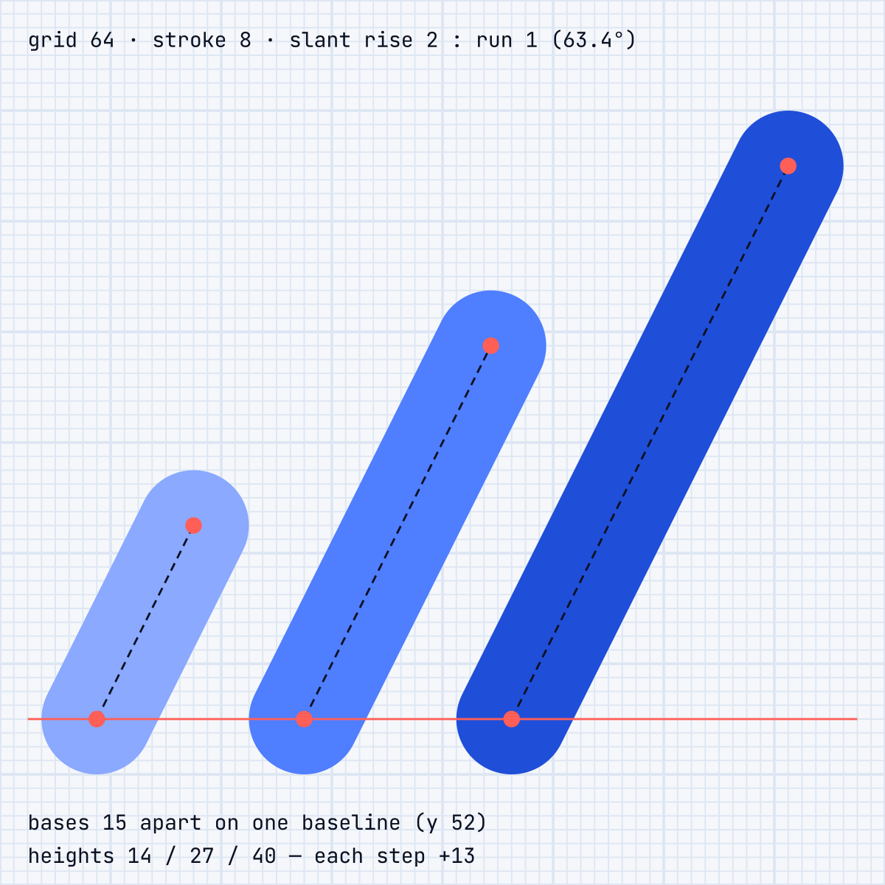

# Ahoo Skills 品牌资产

## Logo：三道递进的斜杠


### 从第一性原理推导

Logo 要回答两个问题：它出现在哪里，它在说什么。

**出现在哪里** 决定了形式上的约束：

- 最常见的尺寸很小：浏览器标签页 16 px、GitHub 头像、站点顶栏 28 px。
  所以只能用极少的几何元素，任何细节在 16 px 时都要至少 1 px 宽。
- 会出现在浅色和深色背景、单色印刷、终端截图里。
  所以辨识度必须来自形状，而不是颜色或渐变。

**在说什么** 来自这个仓库的本质：项目维护者把“如何正确使用这个库”写成
skill，Agent 在需要时加载它。

- `/` 是在 Claude Code 和 Codex 里调用 skill 和插件的方式（`/plugin install …`）。
- `///` 是 Rust、C#、Swift 等语言里的文档注释，skill 的本质就是写给 Agent 的文档。
- 三道斜杠逐级升高，表示 Agent 装上 skill 之后能力的提升，也对应
  “源仓库 → 插件市场 → 你的 Agent”这条分发链路。

三道斜杠，一个形状，同时表达这三层含义。

### 构造



- 64 单位网格，笔画宽 8，圆头端点。
- 斜率为升 2 : 进 1（63.4°）。
- 三道斜杠的底端都落在 y = 52 的同一条基线上，水平间距 15。
- 高度依次为 14 / 27 / 40，每级增加 13。
- 相邻斜杠的垂直间隙为 5.4 单位，16 px 时仍有 1.35 px，不会粘连。

所有 SVG 都由这一组数字生成，改动时请同步修改全部文件。

## 文件

| 文件 | 用途 |
|---|---|
| `logo/svg/skills-mark.svg` | 标志，浅色背景（由浅到深的蓝色阶） |
| `logo/svg/skills-mark-dark.svg` | 标志，深色背景（品牌蓝 → 青 → 薄荷绿） |
| `logo/svg/skills-mark-mono.svg` / `skills-mark-white.svg` | 单色标志（Midnight / 白） |
| `logo/svg/skills-icon.svg` | 应用图标：Midnight 圆角方块上的标志，用于 favicon、头像，在任何背景上都清晰 |
| `logo/svg/skills-logo.svg` / `skills-logo-dark.svg` | 横版组合（标志 + “Ahoo Skills”），浅色 / 深色背景 |
| `logo/svg/skills-logo-construction.svg` | 构造图 |
| `logo/png/` | 上述文件的 PNG 导出 |
| `social/skills-og.svg` / `.png` | 1200 × 630 社交分享图，网站使用 `docs/assets/og.png` |
| `tokens/` | 颜色与字体 token（CSS、SCSS、Tailwind、JSON） |

网站与 README 使用的副本在 `docs/assets/logo/`。

## 使用规则

- **背景**：浅色背景用 `skills-mark` / `skills-logo`，深色背景用 `-dark` 版本。
  不确定背景时用 `skills-icon`。
- **颜色**：斜杠的颜色从左到右逐级增强，不要打乱顺序，不要改成渐变。
  无法使用彩色时用单色版本。
- **最小尺寸**：标志 16 px，横版组合宽 120 px。
- **留白**：四周至少留出一道斜杠的笔画宽度（标志高度的 1/8）。
- **不要**：拉伸、旋转、加阴影或描边，改变斜杠的数量、角度或间距，
  在复杂图片上直接放置彩色标志。
- **字标**：“Ahoo” 用中等字重和次要色，“Skills” 用粗体和主色。
  SVG 使用系统无衬线字体（Inter、SF Pro、Segoe UI、Helvetica Neue）。

## 导出

```bash
cd design/assets/logo/svg
rsvg-convert -w 1024 skills-mark.svg -o ../png/skills-mark@1024.png
```

其余 PNG 按 `logo/png/` 中的文件名和尺寸同样导出。

## 颜色

| 名称 | 值 | 用途 |
|---|---|---|
| Midnight | `#0B1020` | 主文字、深色背景、应用图标底色 |
| Electric Blue | `#346CFF` | 主色 |
| Cyan | `#39D0FF` | 强调、深色背景上的高亮 |
| Mint | `#73F0C0` | 深色背景上的最高一级 |
| Cloud | `#F5F7FB` | 浅色背景 |
| Slate | `#6B7280` | 次要文字 |

浅色背景上的标志色阶：`#8AA9FF` → `#4F7EFF` → `#1F4ED8`。

## 说明

仓库使用 Apache-2.0 许可证；品牌资产的授权建议由项目维护者单独声明，
或与项目许可证保持一致。
